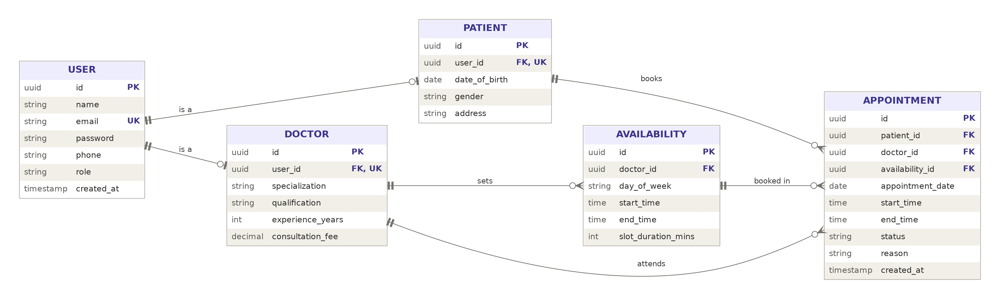

# ER Diagram: Schedule Project Module

Modules covered (in order): User, Patient, Doctor, Availability, Appointment.

## Relationships

| From | To | Type | Meaning |
|------|----|------|---------|
| User | Patient | 1 : 0..1 | A user may have one patient profile |
| User | Doctor | 1 : 0..1 | A user may have one doctor profile |
| Doctor | Availability | 1 : N | A doctor sets many availability slots |
| Patient | Appointment | 1 : N | A patient books many appointments |
| Doctor | Appointment | 1 : N | A doctor attends many appointments |
| Availability | Appointment | 1 : N | An appointment is booked inside one availability slot |
